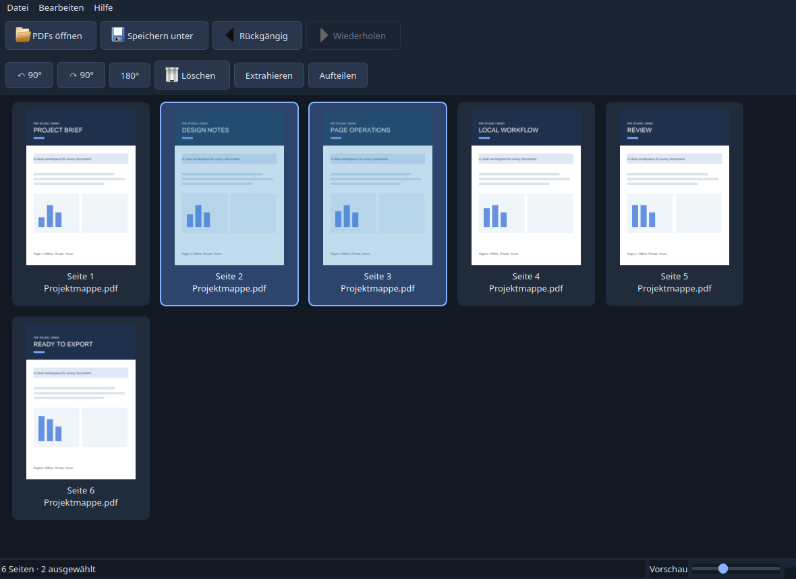

# PDF Studio

Ein nativer, deutscher PDF-Seiteneditor für Windows. PDFs bleiben vollständig
auf deinem Gerät: keine Telemetrie, keine Cloud und keine Netzwerkzugriffe der Anwendung.



Echter Screenshot der Qt-Oberfläche, unter Linux mit einem lokal erzeugten
Beispieldokument aufgenommen. [Leeres Startfenster](docs/screenshots/empty.png).

## Funktionen

- Mehrere PDFs über Dateidialog, Dateidrop oder Kommandozeile hinzufügen.
- Scrollbares Seitenraster mit Vorschauen, Zoom und Strg-/Shift-Mehrfachauswahl.
- Einzelne oder ausgewählte Seiten per Drag & Drop neu anordnen.
- Seiten drehen (links/rechts 90°, 180°), löschen und PDFs zusammenfügen.
- Seiten extrahieren: `4`, `2-8`, `1,3,5,9` oder ausgewählte Seiten.
- Aufteilen nach einer ausgewählten Seite, nach Bereichen (`1-3;4-6`) oder jede Seite einzeln.
- Undo/Redo für Hinzufügen, Verschieben, Drehen und Löschen.
- Sicherer Export mit Schutz der Originaldateien und Warnung bei ungespeicherten Änderungen.
- Asynchrone Imports/Exporte und Vorschauerstellung, begrenzter Vorschaucache.

## Windows-Version herunterladen

[GitHub Releases](https://github.com/JanKarras/PDF-Studio-Lokaler-PDF-Editor/releases)
öffnen und beim Release **v1.0.0** `PDF-Studio-Windows.zip` herunterladen.
Das gesamte ZIP entpacken und `PDF-Studio/PDF-Studio.exe` starten.
Keine Python-Installation notwendig. `_internal` und `licenses` gehören zum
Programmpaket und müssen zusammen mit der EXE im entpackten Ordner bleiben.
Zielplattform: Windows 10/11 x64. Es wird kein Installer benötigt.

Alternativ enthalten erfolgreiche [Windows-Builds](https://github.com/JanKarras/PDF-Studio-Lokaler-PDF-Editor/actions/workflows/windows-build.yml)
das Artifact `PDF-Studio-Windows` (Download erfordert einen GitHub-Login).

## Bedienung

PDFs öffnen, Seiten auswählen und mit der Toolbar bearbeiten. Mehrere Dokumente
werden an den Arbeitsbereich angehängt. Die angezeigte Seitenreihenfolge ist die
Exportreihenfolge. Strg wählt mehrere einzelne Seiten, Shift einen zusammenhängenden
Bereich. Beim Ziehen erscheint eine Einfügemarkierung. `Speichern unter` erzeugt
eine neue PDF; Originaldateien können nicht als Exportziel verwendet werden.

| Tastenkürzel | Aktion |
| --- | --- |
| Strg+O | PDFs hinzufügen |
| Strg+S | Gesamten Arbeitsbereich speichern unter |
| Strg+Z / Strg+Y | Rückgängig / Wiederholen |
| Strg+A | Alle Seiten auswählen |
| Entf | Auswahl löschen (mit Bestätigung) |
| Strg+L / Strg+R | Auswahl links / rechts drehen |
| Strg+E | Seiten extrahieren |
| Strg+Shift+S | PDF aufteilen |

## Lokale Entwicklung

Python 3.12 verwenden. Unter Windows:

```powershell
py -3.12 -m venv .venv
.venv\Scripts\python -m pip install -r requirements-dev.txt
.venv\Scripts\python -m pdf_studio
.venv\Scripts\python -m pytest -q
.venv\Scripts\python scripts/build.py
```

Unter Linux entsprechen die Befehle `.venv/bin/python`. Native Qt-Laufzeitbibliotheken
müssen vom Betriebssystem bereitgestellt werden. Tests können ohne Bildschirm
mit `QT_QPA_PLATFORM=offscreen` ausgeführt werden. Für den Paket-Smoke-Test:

```powershell
.venv\Scripts\python -m pdf_studio --smoke-test --smoke-report smoke-report.json
```

`build.py` sammelt die tatsächlichen Bibliothekslizenzen, erstellt eine
PyInstaller-One-Folder-Distribution, startet die EXE und prüft Rendering,
PDF-Export und Qt-Fenster. Das ZIP wird erst bei erfolgreicher Prüfung erzeugt.
Windows-Pakete müssen auf Windows gebaut werden; Linux-Builds sind keine
Windows-EXEs.

## Architektur und Tests

`pdf_studio/core` enthält PDF-Import, stabile Seitenreferenzen, Operationen,
Undo/Redo, Bereichsparser, Rendering und Export ohne Abhängigkeit von Qt.
`pdf_studio/ui` enthält Raster, Dialoge, Aktionen und Hintergrundjobs.
Quelldateien werden einmal in einen privaten temporären Arbeitsbereich kopiert;
Undo/Redo speichert nur Metadaten. Export öffnet jede benötigte Quelle einmal.
PDFium läuft in einem einzelnen Renderingthread. Nur sichtbare Seiten werden
gerendert; maximal 96 Vorschaubilder bleiben im Cache. Beim Schließen werden
Hintergrundjobs beendet und temporäre Quellen bereinigt.

pytest erzeugt kleine PDFs mit unterschiedlichen Größen, Rotationen und
Seitenmarkierungen. Exportierte Dateien werden erneut geöffnet, um Reihenfolge,
Drehungen und Inhalte zu prüfen. Tests decken Import, Zusammenfügen, Verschieben,
Drehen, Löschen, Extraktion, Aufteilung, Undo/Redo, ungültige Dateien/Bereiche,
Originalschutz, Schreibfehler und konkurrierende Ausgabedateien ab. GUI-Tests
prüfen Tastenkürzel, Dateidrop, Auswahl, Bearbeitung und Speicher-/Aufteilungsdialoge.

## GitHub Actions

`.github/workflows/windows-build.yml` startet bei Push auf `main`, manuell oder
als wiederverwendeter Workflow. Windows führt Tests aus, baut das Paket, startet
die gebaute EXE und veröffentlicht ZIP sowie Prüfreports als Artifacts.
`.github/workflows/release.yml` startet bei Tags wie `v1.0.0`, verwendet denselben
verifizierten Windows-Build und veröffentlicht Windows-ZIP sowie Quellcode-ZIP
mit `GITHUB_TOKEN`. Nur der Veröffentlichungsjob besitzt Schreibrechte.

Die dokumentierten Prüfergebnisse stehen in [docs/VERIFICATION.md](docs/VERIFICATION.md).

## Lizenzen

PDF Studio: **GPL-3.0-or-later**, siehe [LICENSE](LICENSE).
Abhängigkeiten: Python 3.12, PySide6-Essentials 6.10.1 (Qt/PySide6), pikepdf 10.0.2,
pypdfium2 5.3.0 und Pillow 12.0.0. Festgelegte Versionen stehen in
`requirements.txt`; Test-/Buildwerkzeuge in `requirements-dev.txt`.
Details und Quelllinks: [THIRD_PARTY_NOTICES.md](THIRD_PARTY_NOTICES.md).
Der Build übernimmt Lizenztexte der installierten Wheels einschließlich
PDFium-Drittkomponenten und ergänzt Qt-Lizenzen sowie Attributionsdateien aus
den offiziellen Qt-/PySide6-Quellen. Die vollständigen Qt-/PySide6-Quellarchive
stehen im Release als `PDF-Studio-Library-Sources.zip` bereit. Nur dieser
Buildschritt lädt Quellen herunter; die fertige Anwendung bleibt offline.

## Bekannte Einschränkungen

- Passwortgeschützte PDFs werden mit verständlicher Fehlermeldung abgelehnt.
- Keine Textbearbeitung, OCR, Signaturen, Cloud oder komplexe Formularbearbeitung.
- Export übernimmt Seiten, keine dokumentweiten Lesezeichen, Anlagen oder Signaturen.
- Interaktive Formulare, Portfolios und komplexe dokumentweite PDF-Strukturen
  sind nicht Teil des zugesicherten Funktionsumfangs.
- Undo/Redo umfasst die letzten 100 Änderungen; Arbeitsbereiche werden nicht
  über Programmstarts hinweg gespeichert.
- Große Quellen benötigen temporären Speicherplatz; vollständige Quellkopien
  fallen einmal pro Import an. Bei großen Exporten kann die Verarbeitung Speicher benötigen.
- Neue Dateien werden unter Windows ohne Überschreiben umbenannt (auch auf FAT/exFAT).
  Die Linux-Entwicklungsvariante benötigt hierfür Hardlinks; Dateisysteme ohne
  Hardlink-Unterstützung melden einen Speicherfehler.
- Das Windows-Paket ist nicht digital signiert.

Für 1.1 sind Arbeitsbereichspeicherung, Lesezeichenübernahme, weiterführende
Formularunterstützung und Code-Signing sinnvoll.
