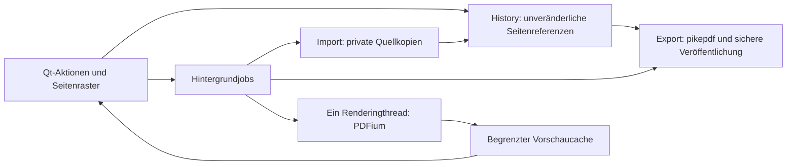

# Architektur

Die Anwendung besteht aus einem unabhängigen PDF-Kern und einer nativen Qt-Oberfläche.

## Verantwortlichkeiten

| Modul | Verantwortung |
| --- | --- |
| `app.py`, `__main__.py`, `run_studio.py` | Entwicklungs- und Paket-Einstiegspunkt |
| `core/model.py` | Stabile UUID, private Quelle, Originalpfad, Quellindex, zusätzliche Rotation |
| `core/importer.py` | Private Quellkopie, Validierung, Verschlüsselungsfehler, mehrere Imports |
| `core/history.py` | Undo/Redo als Metadaten-Snapshots, gespeicherter Zustand |
| `core/operations.py` | Reines Verschieben, Drehen, Löschen und Auswählen |
| `core/ranges.py` | 1-basierte Benutzerbereiche in geprüfte 0-basierte Indizes übersetzen |
| `core/exporter.py` | Quellen einmal öffnen, angezeigte Reihenfolge übernehmen, temporäre PDF prüfen und veröffentlichen |
| `core/splitter.py` | Ausgaben vorab prüfen und bei Fehlschlag bereits erzeugte Teildateien zurücknehmen |
| `core/rendering.py` | PDFium-Bitmap mit eingebetteter und zusätzlicher Rotation |
| `ui/window.py` | Zusammensetzung der Komponenten und Lebensdauer des Arbeitsbereichs |
| `ui/drop_grid.py`, `ui/grid.py` | Dateidrop, interne Seitendrops, Raster und leerer Startzustand |
| `ui/*_actions.py`, `ui/edits.py` | Kleine kohärente Bedienaktionen und Dialoge |
| `ui/tasks.py`, `ui/task_actions.py` | Qt-Hintergrundjobs, Fortschritt, Fehler und Beschäftigtzustand |
| `ui/thumbnails.py` | Sichtbare Seiten, begrenzter Cache, Qt-Bilder ausschließlich im UI-Thread |
| `smoke.py` | Paketstart, reale PDF-Verarbeitung, Qt-Fenster und asynchrone Vorschau verifizieren |
| `scripts/build.py`, `PDF-Studio.spec` | Lizenzen, One-Folder-Build, Smoke-Test, portable ZIPs |

## Invarianten

1. Die Tupelreihenfolge von `History.pages` ist die UI- und Exportreihenfolge.
2. Jede importierte Seite hat eine stabile ID, auch bei mehrfach importierter Quelle.
3. Die Quellen im Arbeitsbereich werden nach dem Import nicht verändert. Sie bleiben
   bis zum Schließen bestehen, damit Undo/Redo auch gelöschte Seiten wiederherstellen kann.
4. Bearbeitungsaktionen verändern nur Metadaten. Die maximale Historie umfasst 100 Änderungen.
5. Export kann keine Originalquelle ersetzen. Dies wird auch bei symbolischen Links
   und Hardlinks geprüft. UI-Exporte schützen alle Quellen des Arbeitsbereichs.
6. Neue Ausgaben werden nach PDF-Prüfung und Flush unter Windows ohne Überschreiben
   umbenannt (unter POSIX per Hardlink veröffentlicht);
   vorhandene, ausdrücklich bestätigte Ausgaben werden per atomarem Austausch ersetzt.
7. Ein neuer Export überschreibt keine zwischenzeitlich von einem anderen Prozess
   erzeugte Ausgabedatei. Nicht unterstützte Dateisysteme liefern einen Fehler.
8. Während Import und Export sind Bearbeitungsaktionen gesperrt; Qt bleibt responsiv.
9. PDFium wird nur vom einzelnen Renderingthread verwendet. Nach erfolgreichem
   Rendering werden Pixel an den UI-Thread übertragen und dort Qt-Pixmaps erzeugt.
10. Normales Schließen wartet auf Hintergrundjobs und bereinigt den privaten
    Arbeitsbereich. Bei laufendem Import/Export wird Schließen zurückgewiesen.

## Grenzen

Die Anwendung bearbeitet Seiten, keine komplette dokumentweite PDF-Struktur.
Lesezeichen, Anlagen und digitale Signaturen werden nicht übernommen. Große
Dateien benötigen Platz für eine Quellkopie und können während des Exports mehr
Arbeitsspeicher benötigen. Laufzeit und RAM hängen vom PDF-Inhalt ab; die Anwendung
verspricht keine beliebige maximale Dokumentgröße. Unter Windows funktionieren neue Ausgaben auch auf FAT/exFAT; die
Linux-Entwicklungsvariante benötigt Hardlink-Unterstützung.
